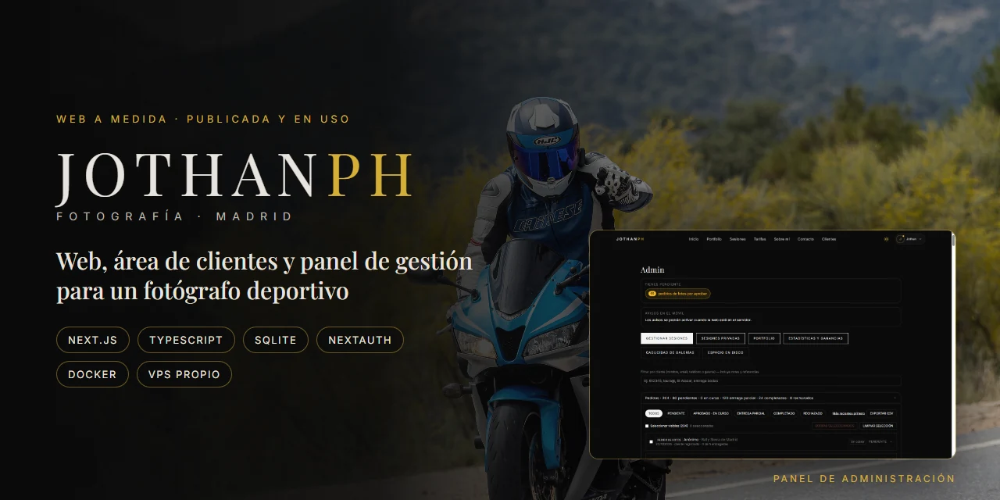
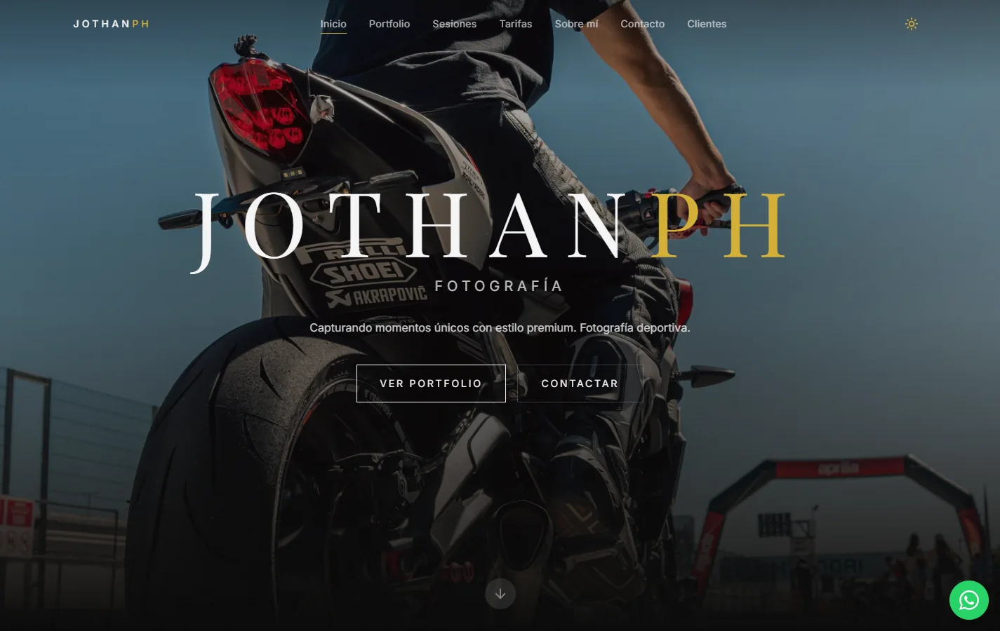
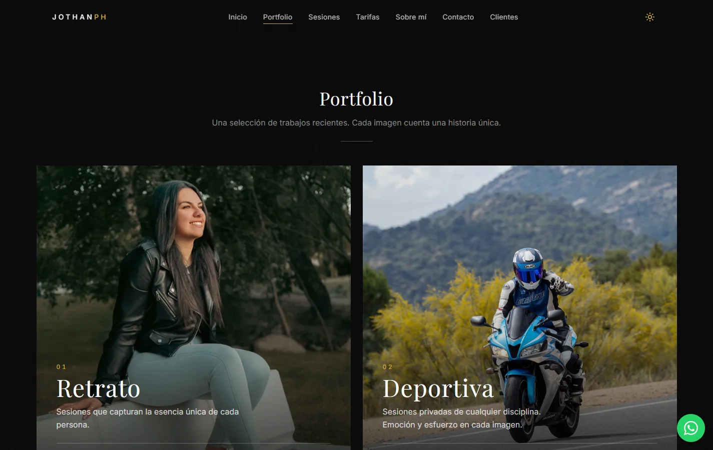
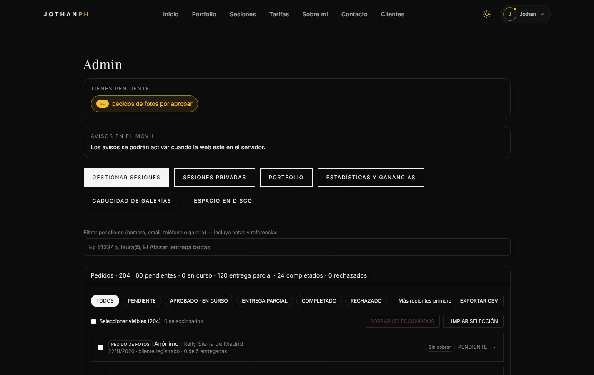
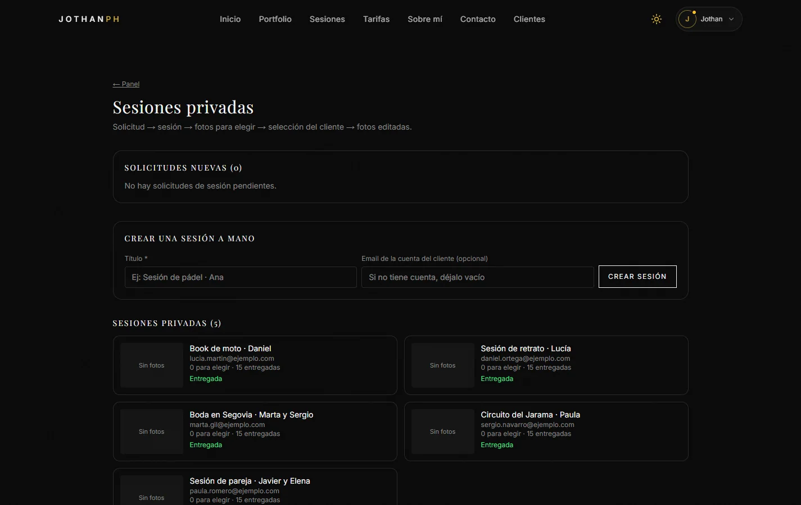

 

**Web completa para un fotógrafo deportivo de Madrid: la parte pública que ven sus clientes y el panel con el que gestiona su negocio. Publicada en un servidor propio y en uso real.**

 

---

## En 30 segundos

No es solo una web bonita: detrás hay una aplicación con usuarios, permisos, pedidos y archivos privados.

- 🖼️ **Parte pública**: portfolio, agenda de sesiones con sus fotos y pedidos, reseñas y contacto.
- 🔐 **Área de clientes**: inicio de sesión, sesiones privadas en las que el cliente elige sus fotos y descarga de los originales.
- 🛠️ **Panel de administración**: el fotógrafo gestiona pedidos, sesiones, clientes, portfolio, cobros y estadísticas sin tocar código.
- 🖥️ **Servidor propio**: VPS Linux con Docker y HTTPS y copias de seguridad diarias cifradas.
- 🚨 **Vigilada las 24 horas**: si la web se cae, nos enteramos al momento por el móvil, antes de que un cliente tenga que avisar.

---

## La web

<b>Portada</b> · estética oscura y dorada, pensada para que las fotos sean las protagonistas.

<b>Portfolio</b> · retrato y deportiva, gestionados por el propio fotógrafo desde el panel.

---

## El panel de administración

La parte más compleja del proyecto. Desde aquí el fotógrafo lleva su negocio en el día a día:

<table>
<tr>
<td width="50%"> <b>Panel</b> · pedidos por estado, filtros, acciones en bloque y exportación a CSV.</td>
<td width="50%"> <b>Sesiones privadas</b> · de la solicitud a la entrega: fotos para elegir, selección del cliente y fotos editadas.</td>
</tr>
</table>

Capturas del panel con datos de demostración: los clientes reales no aparecen.

**Qué gestiona:**

| Área | Qué hace |
|---|---|
| **Pedidos y cobros** | Aprobar, entregar o rechazar pedidos y llevar el registro de cobros, con estadísticas y exportación a Excel. |
| **Agenda de sesiones** | Crear sesiones por año y mes, subir cientos de fotos de una vez y publicarlas con marca de agua. |
| **Sesiones privadas** | Galerías solo para el cliente con permiso, con su selección y la descarga en ZIP. |
| **Clientes** | Cuentas, envío de accesos y revocación de sesiones. |
| **Portfolio y reseñas** | Subir, ordenar y encuadrar fotos; moderar reseñas. |
| **Avisos y mantenimiento** | Avisos al móvil del fotógrafo, caducidad de galerías y control del espacio en disco. |

---

## Vigilada las 24 horas

> 🚨 **Si la web se cae, lo sabemos antes que nadie.** Un servicio externo, UptimeRobot, comprueba cada 5 minutos que la portada carga y que la ruta de salud `/api/health` responde, y esa ruta confirma también que la base de datos funciona. Si algo falla, llega un aviso al momento a la app del móvil y por correo. Así nadie depende de que un cliente escriba para decir que la web no funciona.

A eso se suman los avisos que manda el propio servidor al móvil del administrador: si el disco pasa del 85 % o si la copia de seguridad fuera del servidor falla o lleva más de 36 horas sin subirse.

## Lo que no se ve

| Principio | Cómo se cumple |
|---|---|
| **Permisos en el servidor** | Cada ruta del panel comprueba que quien llama es administrador; las galerías privadas solo se abren con permiso. |
| **Fotos protegidas** | Las vistas públicas llevan una marca de agua propia; los originales nunca son públicos y solo se descargan tras la compra. |
| **Probada contra ataques** | Una auditoría de seguridad lanzó 419 ataques (permisos, datos manipulados, peticiones repetidas) sin fallos. |
| **Límites por IP** | Formularios y pedidos con freno frente a abusos y dobles clics. |
| **Los datos no se pierden** | Un dato dañado da error en lugar de tratarse como vacío; migraciones de base de datos solo aditivas. |
| **Copias de seguridad** | Copia diaria incremental en el servidor y otra cifrada fuera de él, con aviso al móvil si falla. |
| **Aguanta carga** | Prueba en el servidor real: 100 clientes simultáneos sin errores. |

## En cifras

| Concepto | Valor |
|---|---|
| Código | **unas 24.000 líneas** de TypeScript |
| Pruebas unitarias | **más de 580** (Vitest) |
| Pruebas E2E | **87** (Playwright), en 7 tamaños de pantalla y 2 navegadores |
| Prueba de carga | **100 clientes simultáneos** sin errores |
| Auditoría de seguridad | **419 ataques**, sin fallos |

## Tecnologías

**Next.js 15** · **React 19** · **TypeScript** · Tailwind CSS · **SQLite** (Drizzle) · **NextAuth** · Docker · Caddy (HTTPS) · VPS Linux · Vitest · Playwright

## Estado

Publicada en un servidor propio y en uso con clientes reales. Está en una dirección provisional mientras se prepara el paso al dominio del negocio. **El código es privado** porque es la web de un cliente; este repositorio es su presentación.

## Autor

Desarrollada por **Cristian Corroto** con apoyo intensivo de IA en el código y en la puesta en marcha del servidor. Yo defino con el fotógrafo lo que necesita la web, pruebo cada funcionalidad y reviso el resultado antes de publicarlo.

[Ver la web](https://srv2121091.hstgr.cloud/) · [Portfolio](https://cristian-corroto.pages.dev) · [LinkedIn](https://www.linkedin.com/in/cristian-corroto)

---

© 2026 Cristian Corroto. Fotografías de JothanPh Fotografía, mostradas con su permiso.
